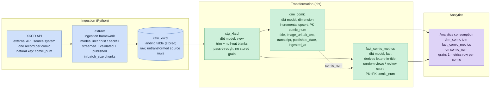

# Architecture: XKCD API to analytics

Left to right: Python ingestion lands raw data, dbt models stage and publish it as a
dimension and fact table, ready for analytics to query.

`raw_xkcd` is the ingestion framework's landing table (Python) - see
[README.md](../../README.md) for the `incr`/`hist`/`backfill` modes, retry/backoff
behavior, and the Airflow DAG (`dags/xkcd_pipeline_dag.py`) that runs this whole flow
end to end on XKCD's publishing schedule. `stg_xkcd` through `fact_comic_metrics` are
dbt models; see [erd.md](erd.md) for the resulting data warehouse model and
[data-quality.md](data-quality.md) for the checks defined at each stage.

`extract` doesn't fetch every comic into memory before writing anything: it streams
records out one at a time, and the ingestion framework groups them into
`loading.batch_size` chunks, validating and publishing each chunk before moving on to
the next. A failure partway through a large `hist`/`backfill` run only costs the current
chunk - everything validated and published before it is already safely in `raw_xkcd`,
and re-running is safe since the destination mode is `upsert`.
