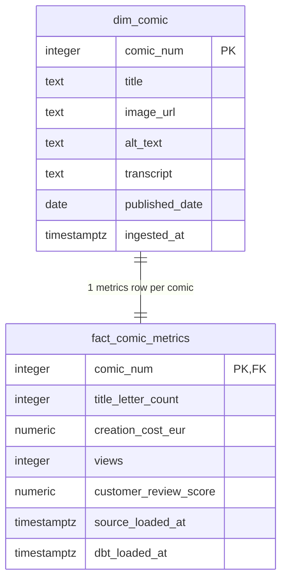

# Data Warehouse Model

One dimension, one fact, both at comic grain. Descriptive attributes that rarely change
live in `dim_comic`; metrics that get recomputed every run live separately in
`fact_comic_metrics`, joined 1:1 on the comic's own natural key.

## Why one fact row per dimension row

A textbook star schema has many fact rows per dimension row (many orders per customer).
Here the fact's grain is identical to the dimension's: exactly one comic. That's
deliberate, not an accident of a small dataset.

- **Different refresh reasons, same key.** `dim_comic`'s columns come straight from the
  XKCD API and only change if a comic is edited upstream. `fact_comic_metrics`'s measures
  (`views`, `customer_review_score`) are recomputed by the transform layer on every run.
  Splitting them means re-deriving metrics never touches - or risks corrupting - the
  source-of-truth descriptive data.
- **No surrogate key needed.** `comic_num` is already a stable, source-assigned
  identifier (XKCD never reassigns a number), so it serves directly as the natural key
  on both sides instead of generating a synthetic one.
- **Type 1, not Type 2.** Both tables are incremental with `delete+insert` on
  `comic_num` - a changed row overwrites in place. There's no history of a comic's title
  or view count over time, which is the right tradeoff here: XKCD comics are essentially
  immutable once published.

Only `dim_comic` and `fact_comic_metrics` appear above - `raw_xkcd` (the ingestion
landing table) and `stg_xkcd` (a pass-through view with no stored grain of its own) sit
upstream of this model. See [architecture.md](architecture.md) for how data reaches these
tables, and [data-quality.md](data-quality.md) for the checks defined on them.
